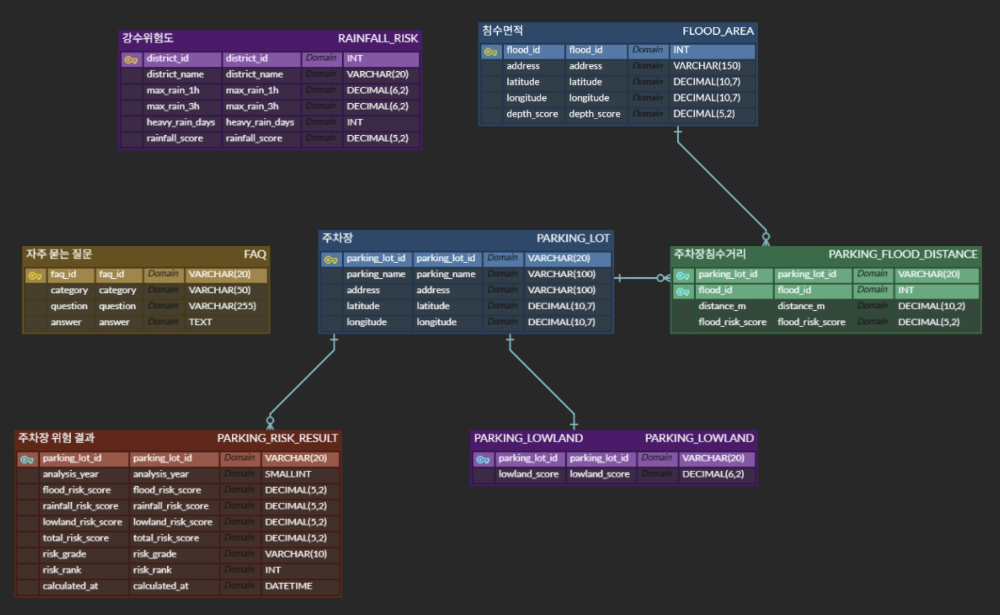

<div align="center">


# 🚘 침착 (CHIMCHAK)

### 데이터 분석 기반 침수 위험 주차장 비교 서비스

**주차 전, 침착하게 확인하세요.**

강수량 · 지형/고도 · 과거 침수 이력을 결합해 **주차장별 상대적인 침수 위험지수**를 비교하는 서비스

**SK Networks Family AI Camp 38기 · 1차 프로젝트**

<!-- 배포 후 실제 주소로 교체
[🌐 서비스 바로가기](https://YOUR-DEPLOYED-URL) · 
-->

</div>

> ⚠️ **안내:** 학습용 데이터 분석 프로젝트입니다. 위험지수는 침수 확률이나 실시간 예측 결과가 아니며, 낮은 점수도 안전을 보장하지 않습니다.


## 📌 목차

- - [팀 소개](#-팀-소개)
- [프로젝트 개요](#-프로젝트-개요)
- [서비스 차별점](#-서비스-차별점)
- [주요 기능](#-주요-기능)
- [서비스 흐름](#-서비스-흐름)
- [공공데이터 및 분석 범위](#-공공데이터-및-분석-범위)
- [데이터 전처리 및 분석](#-데이터-전처리-및-분석)
- [침수 위험지수 산정](#-침수-위험지수-산정)
- [시스템 구성](#-시스템-구성)
- [기술 스택](#-기술-스택)
- [데이터베이스 설계 (ERD)](#-데이터베이스-설계-erd)
- [프로젝트 구조](#-프로젝트-구조)
- [실행 방법](#-실행-방법)
- [분석의 한계](#-분석의-한계)
- [향후 계획](#-향후-계획)
---

## 👥 팀 소개

<table width="100%">
  <tr>
    <td align="center" width="25%" valign="top">
      <br>
      <strong>이다민</strong><br>
      <sub><strong>Project Lead<br>Data Engineering</strong></sub>
    </td>
    <td align="center" width="25%" valign="top">
      <br>
      <strong>황도연</strong><br>
      <sub><strong>Data Analysis<br>Service Planning</strong></sub>
    </td>
    <td align="center" width="25%" valign="top">
      <br>
      <strong>박정욱</strong><br>
      <sub><strong>Frontend Development<br>Data Processing</strong></sub>
    </td>
    <td align="center" width="25%" valign="top">
      <br>
      <strong>백은규</strong><br>
      <sub><strong>UI/UX Design<br>Map Integration</strong></sub>
    </td>
  </tr>
  <tr>
    <td width="25%" valign="top">
      <sub>
        • 프로젝트 총괄 및 서비스 기획 주도<br>
        • ERD 설계 및 DB 구축·적재<br>
        • 데이터 정제·정규화 및 전처리
      </sub>
    </td>
    <td width="25%" valign="top">
      <sub>
        • 강수량 데이터 조사·수집<br>
        • 데이터 연관성 분석 및 전처리 로직 설계<br>
        • 시장 조사 및 문제 정의<br>
        • 프로젝트 발표 및 서비스 시연
      </sub>
    </td>
    <td width="25%" valign="top">
      <sub>
        • 프론트엔드 기능 개발<br>
        • Git/GitHub 저장소 관리<br>
        • 지형·고도 데이터 조사·수집<br>
        • 데이터 정제·정규화 및 전처리
      </sub>
    </td>
    <td width="25%" valign="top">
      <sub>
        • 서비스 기능 테스트 및 품질 검증(QA)<br>
        • 프론트엔드 UI 디자인<br>
        • 침수흔적도 데이터 조사·수집 및 전처리
      </sub>
    </td>
  </tr>
</table>

## 💡 프로젝트 개요

### 문제 정의

집중호우 시 주차된 차량도 침수 피해를 입을 수 있습니다. 일반적인 주차장 정보는 위치·요금·운영시간 등 이용 편의성 중심이어서 **주변 지형과 과거 침수 이력까지 함께 비교하기 어렵습니다.**

**핵심 질문:** 현재 위치 주변 주차장 중 상대적으로 침수 위험지수가 낮은 곳은 어디일까?

### 프로젝트 목표

공공데이터로 주차장별 **강수량·저지대·과거 침수 이력**을 분석하고, 사용자가 **위치·거리·상대 위험지수**를 함께 비교하도록 돕습니다.

### 서비스 대상

| 대상 | 이용 상황 | 제공 정보 |
|:---|:---|:---|
| 주변 주차장을 찾는 운전자 | 목적지 인근 주차장 탐색 | 거리와 위험지수 비교 |
| 집중호우 시기 주차를 고민하는 운전자 | 주차 전 위험요인 확인 | 강수·지형·침수 이력 점수 |
| 지역별 위험 특성에 관심 있는 사용자 | 지역의 상대적 위험 분포 확인 | 분석 대시보드 |

## 🆚 서비스 차별점

| 일반적인 주차장 정보 | 침착(CHIMCHAK) |
|:---|:---|
| 주차장 위치·요금·운영시간 중심 | 위치와 함께 **침수 위험요인** 비교 |
| 주차장까지의 거리 확인 | **거리·위험지수**를 함께 정렬·비교 |
| 침수 관련 판단 자료가 분산됨 | 강수·저지대·과거 침수 이력 **세부 점수** 제공 |
| 위험지수 해석 안내가 없음 | **상대점수의 한계**를 함께 안내 |

> 이 표는 서비스의 기획상 차별점을 정리한 것이며, 특정 경쟁 서비스의 기능을 조사·검증한 비교표는 아닙니다.

## ✨ 주요 기능

| 구분 | 기능 | 설명 |
|:---|:---|:---|
| 탐색 | 위치 기반 주차장 검색 | 현재 위치 주변 주차장 조회, 500m·1km·1.5km·2km 반경 선택 |
| 탐색 | 지도·목록 보기 | 주차장명·주소·거리·종합 위험지수 확인 |
| 분석 | 세부 위험요인 확인 | 강수량·저지대·과거 침수 이력 점수 제공 |
| 비교 | 주차장 비교 | 위험지수 낮은 순·높은 순·거리순 정렬 |
| 시각화 | 분석 대시보드 | 위험지수 분포 파이차트·막대그래프 |
| 안내 | FAQ | 점수 산정 기준·자료 기간·해석 한계 설명 |

<!-- 시연 이미지 준비 후 주석 해제


-->

## 🔄 서비스 흐름

```text
01 위치정보 동의 및 주변 주차장 탐색
             ↓
02 탐색 반경 선택 (500m / 1km / 1.5km / 2km)
             ↓
03 지도·목록에서 주차장 선택
             ↓
04 종합 위험지수와 세부 위험요인 확인
             ↓
05 거리·위험지수 비교 후 주차장 선택에 참고
```

## 🗂 공공데이터 및 분석 범위

| 데이터 | 제공 기관 | 활용 목적 |
|:---|:---|:---|
| [전국주차장표준데이터](https://www.data.go.kr/data/15012896/standard.do) | 지방자치단체 (공공데이터포털) | 서울시 주차장 위치·주소·기본정보 수집 |
| [침수흔적도](https://www.safemap.go.kr/opna/data/dataViewRenew.do?objtId=212) | 행정안전부 재난보험과 | 과거 침수 위치·침수심 및 근접성 분석 |
| [방재기상관측(AWS)](https://data.kma.go.kr/data/grnd/selectAwsRltmList.do?pgmNo=56) | 기상청 | 2025년 시간별 강수량을 이용한 강수 위험도 산출 |
| [서울시 경사도](https://data.seoul.go.kr/dataList/OA-22241/F/1/datasetView.do) | 서울특별시 도시공간본부 도시계획상임기획과 | 표고점·등고선 등 관련 지형자료를 활용한 상대 고도 차이 분석 |


### 분석 범위

| 구분 | 규모 / 범위 |
|:---|:---|
| 수집·분석 주차장 | **806곳** |
| 과거 침수구역 | **1,132곳** |
| 과거 침수구역 대표 위치에서 1km 이내 주차장 | **204곳** |
| 강수 위험도 분석 대상 5개 자치구 내 주차장 | **163곳** |
| **두 조건을 모두 만족하는 최종 분석 주차장** | **137곳** |
| 강수량 기준 기간 | **2025년** |
| 강수 분석 지역 | **은평구 · 강서구 · 서대문구 · 도봉구 · 강북구** |

**대상 선정 시 주의**: 204곳과 163곳은 각각 서로 다른 조건으로 추린 집합이며, **최종 137곳은 두 집합의 교집합**입니다. 따라서 `806 → 204 → 163`을 순차적 필터링 결과로 해석하면 안 됩니다.

## 📊 데이터 전처리 및 분석

```text
공공데이터 수집 (주차장 · AWS · 침수흔적 · 지형)
              ↓
결측치·중복·시간·좌표 정리
              ↓
주차장 위치를 기준으로 공간정보 연결
              ↓
강수 위험도 / 저지대 위험도 / 침수 이력 위험도 계산
              ↓
지표별 점수 표준화 및 가중 결합
              ↓
두 선정 조건의 교집합 137곳 최종 분석
              ↓
지도 · 주차장 비교 · 대시보드 시각화
```

## 📐 침수 위험지수 산정

침착의 위험지수는 **실제 침수 발생 확률이 아닌, 분석 대상 주차장 간 상대적인 비교를 위한 점수**입니다.

### 1. 강수량 위험도 (Rainfall Risk Score)

2025년 시간별 AWS 관측자료를 기반으로 세 가지 지표를 사용합니다.

| 세부 지표 | 비중 | 의미 |
|:---|---:|:---|
| 연최대 1시간 강수량 | 40% | 단시간 강우강도 |
| 연최대 연속 3시간 누적강수량 | 40% | 3시간 이동합의 연중 최댓값 |
| 3시간 누적강수량 60mm 이상 발생일 수 | 20% | 강한 강우의 발생 빈도 |

3시간 60mm는 호우주의보의 강수량 기준을 참고한 **분석상 임계값**입니다. 해당 일수는 실제 호우주의보 발령일 수와 동일하지 않습니다.

### 2. 저지대 위험도 (Lowland Risk Score)

주차장 고도와 **반경 300m 내 고도 중앙값**의 차이를 비교합니다.

```text
상대 고도 차이(m) = max(0, 주변 300m 고도 중앙값 - 주차장 고도)
저지대 점수(0~100) = min(100, 상대 고도 차이 / 9.1236 × 100)
```

- `9.1236m`: 주변보다 낮은 주차장 **442곳**의 상대 고도 차이 중 95백분위수
- `300m`: 국지적 지형 비교를 위해 정한 범위이며 실제 침수 영향권이 아님

### 3. 과거 침수 이력 위험도 (Flood Risk Score)

- 주차장과 과거 침수구역 대표 좌표 사이의 **하버사인 직선거리** 계산
- 각 주차장에서 가장 가까운 침수구역까지의 거리 산출
- **1,000m 이내** 여부를 분석 대상 선정 및 근접성 평가에 활용
- 과거 침수심을 최대 침수심 기준으로 **0~1 표준화**하여 과거 침수의 깊이 반영

`1,000m`는 팀이 설정한 분석 기준이며 실제 침수 확산 거리나 안전 경계가 아닙니다. 과거 침수심 역시 미래 침수심의 예측값이 아닙니다.

### 4. 종합 침수 위험지수

```text
종합 위험지수 = (강수 위험도 × 0.30)
              + (저지대 위험도 × 0.25)
              + (과거 침수 이력 위험도 × 0.45)
```

| 위험 요인 | 가중치 | 설정 취지 |
|:---|---:|:---|
| 강수량 | **30%** | 침수 유발 요인이지만 단독으로 개별 주차장의 침수를 설명하기 어려움 |
| 저지대 | **25%** | 지형적 취약성을 반영하지만 실제 침수 발생을 직접 의미하지 않음 |
| 과거 침수 이력 | **45%** | 실제 침수 위치와 침수심을 포함하는 경험적 근거 |

> 가중치는 팀이 분석 목적에 맞게 설정한 값으로, 통계적으로 최적화되거나 미래 침수 예측 성능이 검증된 값은 아닙니다.

---

## 🏗 시스템 구성

```text
공공데이터 (주차장 · 기상청 AWS · 침수흔적 · 지형)
                         ↓
              Pandas 전처리·결합
                         ↓
           NumPy 및 거리·위험도 계산
                         ↓
                 MySQL 데이터 관리
                         ↓
             Streamlit 웹 대시보드
                 ↙             ↘
          Altair 그래프       Pydeck 지도
```

> 구성도는 프로젝트에서 사용한 주요 기술의 **논리적 역할**을 표현하며, 실제 파일·서버 배포 구조를 뜻하지 않습니다.

## 🛠 기술 스택

| 분야 | 기술 | 프로젝트 활용 |
|:---|:---|:---|
| Language | **Python** | 전처리·분석·서비스 로직 |
| Data Analysis | **Pandas** | 데이터 로딩, 결측치 정리, 병합, 그룹별 분석 |
| Numerical Computing | **NumPy** | 수치 연산, 조건별 점수 계산, 표준화 보조 |
| Web | **Streamlit** | 검색·비교·대시보드 화면 |
| Database | **MySQL** | 전처리 데이터 및 분석 결과 관리 |
| Collaboration | **Git / GitHub** | 버전 관리 및 팀 협업 |

**활용 분석 방법**

| 분석 기법 | 역할 |
|:---|:---|
| 시계열 이동합 | 연최대 연속 3시간 강수량 계산 |
| Haversine | 주차장 ↔ 과거 침수구역 대표 좌표 간 지표면 최단거리 계산 |
| 상대 고도 비교 | 주차장 고도 ↔ 반경 300m 고도 중앙값 비교 |
| 가중합 | 강수·저지대·침수 이력 점수 통합 |


## 🗄️ 데이터베이스 설계 (ERD)

<div align="center">
  
  <br>
  <sub>침착(CHIMCHAK) 데이터베이스 ERD</sub>
</div>

침착은 MySQL 기반의 관계형 데이터베이스를 활용하며,
총 **7개 테이블**로 구성되어 있습니다.


## 📂 프로젝트 구조

<details>
<summary>폴더 구조</summary>

```text
project/
├── app.py
├── launch.py
├── pages/
│   ├── 0_Home.py
│   ├── 1_FAQ.py
│   └── 2_Analysis_Results.py
├── services/
├── scripts/
├── data/
│   ├── raw/
│   ├── processed/
│   └── risk_config.json
├── sql/
├── tests/
├── docs/
├── assets/
├── .streamlit/
├── requirements.txt
└── README.md
```

</details>

## 🚀 실행 방법

```bash
# 저장소 복제 
git clone https://github.com/SKNETWORKS-FAMILY-AICAMP/SKN38-1st-4Team.git
# 프로젝트 폴더 이동
cd SKN38-1st-4Team
```

**1. 가상환경 생성 및 활성화**

```bash
python -m venv .venv

# Windows
.venv\Scripts\activate

# Mac / Linux
source .venv/bin/activate
```

**2. 라이브러리 설치**

```bash
pip install -r requirements.txt
```

**3. Streamlit 실행**

```bash
streamlit run app.py
```

Windows에서는 `실행.bat`을 통해서도 실행할 수 있습니다.
배포 플랫폼에서 요구하는 환경변수나 비밀키가 있다면 공개 저장소에 업로드하지 말고 배포 서비스의 Secrets/환경변수 설정을 사용하세요.

### API 키 관리

API 인증키는 `.env`와 같은 비공개 설정 파일 또는 배포 환경의 Secrets에 저장하고, `.gitignore`로 실제 키가 Git에 포함되지 않도록 관리합니다. 팀원에게는 키 이름만 적은 `.env.example`을 공유할 수 있습니다.

## ⚠️ 분석의 한계

1. **상대점수 ≠ 침수 확률**: 80점은 침수 확률 80%를 의미하지 않습니다.
2. **실시간 예측 아님**: 2025년 강수 관측자료, 과거 침수 이력, 지형자료를 기반으로 합니다.
3. **분석 범위 제한**: 최종 분석 대상은 **137곳**이며, 분석 결과가 없는 주차장을 안전하다고 해석해서는 안 됩니다.
4. **미반영 요인 존재**: 배수시설 상태, 실시간 하천 수위, 현장 통제 상황 등은 충분히 반영하지 못할 수 있습니다.
5. **안전 안내 우선**: 집중호우·침수 경보 시 기상특보, 재난 당국의 안내, 현장 통제를 우선해야 합니다.

## 🗺 향후 계획

아래 항목은 **검토 가능한 개선 방향**이며, 현재 구현 완료 기능이 아닙니다.

- 강수량·침수 이력의 기준 연도 확장 및 데이터 누락 개선
- 배수시설·실시간 하천 수위 등 미반영 위험요인 검토
- 과거 피해 사례를 활용한 위험지수 검증
- 지도·차트 사용성과 모바일 화면 개선

---

<div align="center">

### 🚘 주차 전, 침착하게 확인하세요.

*데이터로 더 신중한 주차 선택을 돕겠습니다.*

</div>
